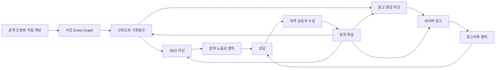

# 사건 수요 대응 OS — 제품 목표, 목표 구조와 GTM 정본

상태: 제품 전략 정본
적용 범위: `lawfirm-ads` 저장소
현재 beachhead: 금융사기 사건을 반복적으로 수임하는 대한민국 법률사무소

이 문서는 `lawfirm-ads`가 무엇을 완성해야 하는지, 어떤 구조로 발전해야 하는지, 누구에게 어떤 방식으로 판매할지를 정의한다. 구현 현황과 실행 방법은 `docs/PRODUCT.md`가 설명하며, 두 문서가 충돌할 경우 제품 목표·아키텍처·GTM 결정은 이 문서를 우선한다.

---

## 1. 최종 목표

이 제품은 대량 페이지 제작기나 광고대행 도구가 아니다.

> 새 금융사기 사건명이 검색되기 시작하는 순간을 경쟁사보다 먼저 감지하고, 법률사무소별 SEO 페이지와 광고 랜딩을 준비·배포하며, 검색광고·상담·수임 결과를 같은 사건 단위로 연결해 다음 의사결정을 더 정확하게 만드는 사건 수요 대응 OS가 된다.

완벽한 제품은 다음 질문에 매일 답한다.

1. 오늘 새로 등장하거나 급증한 사건은 무엇인가?
2. 그중 실제 피해 사건일 가능성과 검색 수요가 높은 것은 무엇인가?
3. 이 법률사무소가 지금 대응할 가치가 높은 사건은 무엇인가?
4. 어떤 SEO 콘텐츠와 광고 랜딩을 공개해야 하는가?
5. 어떤 키워드에 얼마를 집행하고 무엇을 중지해야 하는가?
6. 어떤 유입이 적격 상담과 실제 수임으로 이어졌는가?
7. 그 결과를 반영하면 내일의 수집·콘텐츠·입찰 결정은 어떻게 달라져야 하는가?

### 제품이 판매하는 것

- 경쟁사보다 빠른 사건 발견
- 근거가 연결된 사건 식별과 정규화
- 법률사무소별 대응 자산의 신속한 배포
- 광고비와 상담 성과의 사건 단위 귀속
- 적격 상담과 수임 결과에 기반한 운영 추천
- 고객 수가 늘어도 반복 인력이 늘지 않는 운영 자동화

### 제품이 판매하지 않는 것

- 페이지 개수
- 검색 순위 보장
- 상담 또는 수임 보장
- 법률 상담이나 사건 중개
- 광고비 비율 또는 성공보수형 대가
- 근거 없는 피해 사실과 과장된 성과 수치
- 범용 홈페이지 빌더 또는 범용 CRM

---

## 2. 시장을 지배한다는 것의 정의

시장 지배는 가장 많은 URL을 보유하는 상태가 아니다. 아래 네 가지 우위를 동시에 확보한 상태다.

### 2.1 Signal advantage

새 사건을 경쟁사보다 먼저 발견하고, 동일 사건의 별칭·앱·도메인·채널을 더 정확히 연결한다.

### 2.2 Decision advantage

관측량뿐 아니라 신뢰도, 증가속도, 검색 수요, 광고비, 적격 상담률과 수임 결과를 이용해 어떤 사건에 먼저 대응할지 더 잘 결정한다.

### 2.3 Distribution advantage

고객 법률사무소의 도메인과 광고계정으로 SEO·검색광고를 가장 빠르고 일관되게 실행한다.

### 2.4 Outcome advantage

페이지·광고·상담·수임을 같은 사건 ID로 연결하고, 누적 결과를 다음 고객과 다음 사건의 의사결정에 활용한다.

페이지 생성과 네이버 API 연동은 복제 가능한 기능이다. `사건 Entity Graph + Outcome Graph + 반복 운영 데이터`가 방어력이다.

---

## 3. North Star와 제품 지표

### North Star

> 활성 법률사무소당 월간 귀속 가능 적격 상담 수

수임가액을 제공하는 고객에게는 보조 North Star로 `귀속 가능 수임 기여액 구간`을 사용한다. 페이지 수와 전체 키워드 수는 공급 지표일 뿐 North Star가 아니다.

초기 트래픽이 적어 최종 North Star가 느리게 움직이는 동안에는 `WQRC(Weekly Qualified Response Coverage)`를 leading metric으로 사용한다.

> 매주 새로 검증된 사건 중, 특정 법률사무소에 근거 있는 공개 페이지, 작동하는 상담 CTA, 추적 가능한 SEO 또는 승인 광고 경로가 모두 준비된 `firm_id × case_entity_id` 수

WQRC는 준비 상태를 측정하고, North Star는 실제 고객 결과를 측정한다. WQRC만 높고 적격 상담이 늘지 않으면 성공이 아니다.

### 핵심 지표 트리

| 구분 | 지표 |
|---|---|
| 발견 | 신규 신호 수, 중복 병합 정확도, 독립 출처 수, 발견 지연시간 |
| 판단 | 검증 통과율, 기회점수 calibration, 잘못된 사건명 비율 |
| 발행 | 발견→검토 가능 p95, 승인→공개 p95, 공개 성공률, placeholder 0건 |
| SEO | 색인율, 색인 소요시간, 노출 검색어, 노출수, 클릭수, CTR, 평균 순위 |
| 광고 | 노출, 클릭, 비용, CPC, 심사 통과율, 예산 소진율 |
| 상담 | 유입 귀속률, 적격 상담률, 최초 응답시간, 미응답 리드 수 |
| 수임 | 상담→수임률, 수임당 비용, 미수임 사유, 수임 기여액 구간 |
| 고객 | 활성화 시간, 주간 활성 고객, 3개월 유지율, 고객당 운영시간 |
| 품질 | 정정률, 저근거 공개율, 중복 콘텐츠율, 실패 작업 backlog, SLA 위반 |

### 절대 가드레일

- 출처가 경쟁사 사이트맵 제목 하나뿐인 항목은 공개하지 않는다.
- 사건 고유 근거가 없는 페이지는 `noindex` 미리보기로만 유지한다.
- 미확정 placeholder, `#` 링크, 잘못된 법무법인 정보가 있으면 공개를 차단한다.
- 광고비·수임·매출이 귀속되지 않은 수치를 ROI로 표현하지 않는다.
- 고객 승인 범위를 벗어난 광고 집행과 비용 변경은 자동 실행하지 않는다.

---

## 4. 목표 제품 플라이휠



고객 수가 늘어날수록 더 많은 결과 데이터가 쌓이고, 사건 선택·콘텐츠·입찰·전환이 개선되어야 한다. 고객이 늘어도 단순히 `firm_keywords` 행과 운영 인력만 증가한다면 네트워크 효과가 아니다.

---

## 5. 제품 도메인 구조

목표 구조는 중앙 공유 자산과 법률사무소별 자산을 명확하게 나눈다.

### 5.1 Case Intelligence — 중앙 사건정보

책임:

- 소스 등록과 수집 실행
- 원시 신호 보존
- 사건명 후보 추출
- 중복·별칭·오탈자 병합
- 사건, 앱, 도메인, 채널, 기관 관계 연결
- 출처 독립성과 신뢰도 계산
- 정정·병합·차단 이력 관리

핵심 엔티티:

- `sources`, `source_runs`, `source_items`
- `case_entities`, `case_aliases`, `case_links`
- `observations`, `evidence_facts`, `entity_relations`
- `case_revisions`, `corrections`

### 5.2 Opportunity Engine — 대응 우선순위

책임:

- 사건 신뢰도
- 최근 증가속도
- 독립 출처 수
- 검색 수요와 검색경쟁
- 예상 CPC와 광고 심사 가능성
- 고객별 과거 적격상담·수임 성과
- 고객의 사건 선호와 처리역량

출력:

- 전역 `case_opportunity_score`
- 고객별 `firm_case_opportunity`
- `publish`, `watch`, `hold`, `block` 추천
- 추천 사유와 입력값 snapshot

점수는 설명 가능해야 하며, 운영자와 고객이 왜 추천됐는지 확인할 수 있어야 한다.

### 5.3 Content & Publishing — SEO와 광고 자산

SEO 자산과 광고 랜딩을 별도 엔티티로 관리한다.

```text
content_assets
  - asset_type: seo_page | ad_landing
  - case_entity_id
  - firm_id
  - template_version
  - content_version
  - evidence_snapshot_id
  - status

publications
  - content_asset_id
  - domain_id
  - url
  - canonical_url
  - index_policy
  - deployed_version
  - published_at
  - last_verified_at
```

SEO 상태:

```text
draft → evidence_ready → quality_review → approved → published → indexed
                                      ↘ rejected
published → stale → refreshed
published → blocked
```

광고 랜딩 상태:

```text
draft → brand_review → approved → published → experiment_live → winner|retired
```

Higgs는 `ad_landing`의 이미지·스타일프레임·시각 변형 생성에 사용한다. 키워드마다 무조건 새 이미지를 생성하지 않고, 성과가 검증된 템플릿과 필요한 사건별 자산을 조합한다.

### 5.4 Search Intelligence — SEO 결과

책임:

- 네이버 서치어드바이저·Google Search Console 연결
- URL별 색인 상태
- 검색어별 노출·클릭·CTR·순위
- 색인 지연과 제외 사유
- 콘텐츠 버전 전후 변화
- 내부링크와 refresh 추천

핵심 엔티티:

- `search_integrations`
- `search_url_status`
- `search_query_stats`
- `content_refresh_recommendations`

### 5.5 Advertising — 광고 실행과 최적화

책임:

- 고객 광고계정과 비즈채널 연결
- 캠페인·그룹·키워드·소재 등록
- 심사 결과 동기화
- 비용·노출·클릭·검색어 수집
- 예산 pacing과 pause 제안
- 랜딩·소재 실험

핵심 엔티티:

- `ad_accounts`, `ad_policies`
- `ad_campaigns`, `ad_groups`, `ad_keywords`, `ad_creatives`
- `ad_review_events`, `ad_daily_stats`, `search_terms`
- `budget_actions`, `ad_experiments`

고객은 월예산, 일예산, 입찰 상한, 자동 실행 범위를 사전에 정책으로 승인한다. 엔진은 그 경계 안에서만 자동 실행한다.

### 5.6 Acquisition & Outcome — 상담과 수임

모든 touchpoint가 광고·검색·콘텐츠 자산과 연결되어야 한다.

```text
visitor_session
→ touchpoint
→ event
→ lead
→ lead_status_history
→ qualification
→ consultation
→ matter_outcome
```

필수 데이터:

- 최초·최종 유입
- 검색어와 광고 entity ID
- SEO/광고 랜딩과 variant
- 적격/부적격 및 사유
- 연락·상담 시각
- 수임/미수임 및 사유
- 선택적 예상·확정 수임가액 구간

전화 클릭은 통화 성공이 아니며, 폼 제출은 적격 상담이 아니다. 고객 대시보드는 이 차이를 유지한다.

### 5.7 Tenancy — 법률사무소 workspace

책임:

- 법률사무소, 사용자, 역할
- 도메인과 브랜드
- 변호사와 수행사례
- 광고계정과 승인 정책
- 알림 채널
- 데이터 export와 offboarding

핵심 엔티티:

- `firms`, `firm_users`, `memberships`
- `domains`, `brand_profiles`
- `firm_integrations`, `notification_channels`
- `firm_policies`

### 5.8 Operations — 무인 운영 기반

shell은 수집 순서와 스케줄을 시작하는 진입점으로만 두고, 재시도·임대·실패 상태는 내구성 있는 job 단위로 관리한다.

핵심 엔티티:

- `jobs`, `job_attempts`, `job_leases`
- `approval_tasks`
- `deployments`, `deployment_checks`
- `alerts`, `incidents`
- `daily_reports`

필수 동작:

- idempotency key
- claim/lease
- retry/backoff
- dead-letter
- tenant별 rate limit
- 실행 재개
- 배포 후 health check
- 즉시 cache invalidation
- operator escalation

초기에는 Kafka나 독립 마이크로서비스를 도입하지 않는다. Neon Postgres 기반 queue와 outbox를 사용하는 modular monolith로 시작하고, 처리량과 장애 격리 요구가 실제로 증명될 때 worker를 분리한다.

### 5.9 정본 식별자와 이벤트 계약

- `case_entity_id`: 사건의 정본 식별자
- `content_asset_id`: SEO 또는 광고 랜딩 자산 식별자
- `publication_id`: 고객 도메인에 공개된 배포 식별자
- `ad_execution_id`: 고객 계정의 광고 실행 식별자
- `session_id`: 방문 세션 식별자
- `lead_id`: 상담 리드 식별자
- `job_id`: 비동기 작업 식별자

`slug`는 URL과 호환을 위한 별칭이며 관계 조인의 정본으로 사용하지 않는다. 모든 고객 실행 데이터에는 `firm_id`를 강제한다.

상태 변경 이벤트는 append-only envelope를 사용한다.

```text
event_id, event_type, aggregate_id, firm_id?, actor,
occurred_at, recorded_at, correlation_id, causation_id,
schema_version, policy_version, idempotency_key, payload
```

핵심 이벤트 예시는 다음과 같다.

```text
signal.observed → case.corroborated → case.approved
→ seo.published | ad.submitted → ad.live
→ lead.created → lead.qualified → consultation.booked
→ matter.retained | matter.closed
```

---

## 6. 애플리케이션 표면

### 피해자용 법률사무소 사이트

- 사건 허브와 카테고리
- 근거 기반 SEO 사건 페이지
- 광고 전용 랜딩
- 변호사·법률사무소·수행사례
- 전화·카카오·상담 폼
- 법률사무소 자체 브랜드와 도메인만 노출

### 법률사무소 대시보드

첫 화면은 엔진의 전체 키워드 수가 아니라 고객의 결과를 보여준다.

1. 이번 주 광고비·방문·적격 상담·수임
2. 오늘 처리할 신규·지연 리드
3. 새로 추천된 고신호 사건
4. 성과가 낮아 중지 또는 수정이 필요한 사건
5. SEO 색인·노출·순위 변화
6. 광고 심사·예산·성과
7. 사건별 전체 attribution
8. 주간 리포트와 데이터 export

### 운영자 Control Plane

- 전체 source health
- 신규 사건 검토 큐
- 콘텐츠 승인·정정 큐
- 고객 온보딩 진행률
- 법무법인별 publication·광고 backlog
- job 실패·retry·dead-letter
- 배포 버전·도메인·TLS health
- 광고 심사·비용 이상
- 리드 응답 SLA
- 고객별 가치·사용·유지 위험

데모 운영자 화면과 실제 운영자 화면은 같은 데이터 계약을 사용한다. 데모는 정적 버튼이 아니라 격리된 demo workspace에서 실제 action을 수행한다.

---

## 7. 일일 무인 운영 루프

```text
00. source health 확인
01. 증분 수집
02. raw signal 저장
03. entity resolve와 중복 병합
04. evidence 추출·신뢰도 계산
05. opportunity score 갱신
06. publish/watch/hold/block 정책 적용
07. SEO·광고 자산 생성 또는 refresh
08. 자동 품질검사
09. 정책상 필요한 승인 task 생성
10. 승인 범위 안의 publication 실행
11. 광고 등록·심사·상태 동기화
12. 검색·광고 성과 수집
13. 상담·수임 outcome 반영
14. 최적화 추천 또는 승인 범위 내 실행
15. 고객 주간/일일 리포트
16. operator 예외 큐와 SLA 보고
```

파이프라인 완료는 스크립트가 종료된 상태가 아니다. 각 단계의 기대 job 수와 성공 수가 같고, 실패는 retry 또는 명시적 dead-letter 상태이며, 공개 URL과 광고 상태가 후검증된 상태다.

---

## 8. 목표 코드 구조

현재 코드를 한 번에 재작성하지 않는다. 새 기능부터 도메인 경계를 사용하고 기존 코드를 점진적으로 이동한다.

```text
app/
  (product)/              제품 랜딩·데모·도입 문의
  (firm-site)/            피해자용 SEO·광고·프로필 화면
  d/                      고객 control plane
  operator/               운영자 control plane
  api/                    공개 이벤트·리드·integration callback

src/domains/
  intelligence/           sources, signals, entities, evidence
  opportunities/          score와 firm별 추천
  content/                SEO·광고 자산과 version
  publishing/             domain, URL, index, deployment
  advertising/            Naver 등록·심사·stats·optimization
  acquisition/            session, attribution, lead
  outcomes/               qualification, consultation, matter result
  tenancy/                firm, member, role, policy
  operations/             jobs, approval, alerts, SLA

src/platform/
  db/                     schema, repository, transaction
  jobs/                   queue와 worker contracts
  integrations/           Naver, Search Console, notifications
  observability/          logs, metrics, tracing

workers/
  discovery/
  entity-resolution/
  content-generation/
  publishing/
  advertising/
  reporting/

tests/
  unit/
  integration/
  contract/
  e2e/
  fixtures/
```

현재 매핑:

| 현재 | 목표 도메인 |
|---|---|
| `scripts/agent` | `workers/discovery`, `intelligence` |
| `src/lib/scam` | `intelligence`, `content` |
| `src/lib/engine` | `publishing`, `advertising`, `tenancy` |
| `src/lib/dashboard` | 각 도메인의 query service |
| `src/lib/leads`, `tracking` | `acquisition`, `outcomes` |
| `app/admin`, `app/operator` | operator control plane |

마이그레이션 원칙:

1. 기존 라우트와 테이블을 먼저 삭제하지 않는다.
2. 중앙 사건 정본 `case_entities`와 legacy `keywords` mapping을 additive하게 추가한다.
3. repository 경계를 만든 뒤 일정 기간 dual-read·dual-write한다.
4. 파일 원장과 DB의 수량·식별자·상태 parity를 검증한다.
5. `slug` 조인을 정본 ID 조인으로 교체한다.
6. publication과 ad execution을 분리한 뒤 기존 `/f/{slug}`를 compatibility route로 유지한다.
7. job queue가 기존 daily/fast 작업을 동일 결과로 재현한 뒤 shell scheduler 의존을 제거한다.
8. DB가 정본이 된 뒤에만 `data/keywords.json`을 운영 snapshot/export로 낮춘다.

---

## 9. GTM 전략

### 9.1 Beachhead ICP

초기 고객은 아래 조건을 모두 만족하는 법률사무소다.

- 2~10명 규모의 금융사기·투자사기 중심 부티크 또는 전담팀이다.
- 금융사기 사건을 반복적으로 수임한다.
- 대표 또는 전담팀이 신규 사건 유입을 성장 과제로 본다.
- 자체 도메인과 네이버 광고계정이 있다.
- 광고비를 직접 부담하고 성과 데이터를 공유할 의사가 있다.
- 신규 상담에 영업시간 내 신속히 응답할 담당자가 있다.
- 상담의 적격 여부와 수임 결과를 대시보드에 갱신할 수 있다.

제외:

- 금융사기 사건 처리역량이 불명확한 사무소
- 리드 응답 담당자가 없는 사무소
- 수임 결과를 전혀 기록하지 않는 사무소
- 순위·상담·수임 보장을 요구하는 사무소
- 광고계정과 도메인 소유권을 제공하지 않는 사무소

초기 사건 영역은 투자사기·코인·리딩방의 업체명·프로젝트명·앱명으로 제한한다. 중고거래·로맨스스캠·개인회생 등은 반복 가능한 유료 고객이 확인되기 전 확장하지 않는다.

### 9.2 구매자와 사용자

| 역할 | 원하는 결과 |
|---|---|
| 대표변호사 | 광고비 대비 적격 상담과 수임 기여 증명 |
| 마케팅 책임자 | 새 사건 발견·페이지·광고 운영 자동화 |
| 사무장·상담팀 | 우선순위가 있는 리드와 후속처리 SLA |
| 변호사 | 사건 맥락·증거 체크·수임 판단 정보 |

### 9.3 포지셔닝

금지 포지셔닝:

- 법률사무소 홈페이지 제작
- AI SEO 글쓰기
- 키워드 대량등록
- 광고대행보다 싼 도구

사용할 포지셔닝:

> 금융사기 사건명이 검색되기 시작하는 순간부터 법률사무소의 페이지·광고·상담·수임 결과까지 연결하는 사건 수요 대응 시스템

운영 원칙은 `shared intelligence, private execution`이다. 공개 사건 신호·별칭·근거는 중앙에서 개선하고, 고객의 광고비·리드·수임·브랜드 데이터는 workspace별로 분리한다.

### 9.4 Wedge offer

첫 제안은 전체 마케팅 교체가 아니다.

> 최근 등장한 금융사기 사건 중 귀사가 놓친 수요를 찾아, 고신뢰 사건 50~100개를 대상으로 실제 페이지·네이버 광고·상담 귀속을 연결하는 유료 파일럿

제공물:

- 현재 커버리지 gap 보고서
- 법률사무소 브랜드의 실제 사건 페이지와 광고 랜딩
- 고객 네이버 계정의 제한된 파일럿 캠페인
- 사건별 광고비·상담·적격 여부 dashboard
- 주간 운영 보고와 종료 시 ROI review

### 9.5 가격 가설

가격은 페이지 수가 아니라 workspace, 활성 대응 범위와 운영 SLA를 기준으로 한다. 아래 금액은 첫 3~5개 유료 고객에서 검증할 초기 가설이다.

| 상품 | 가격 가설 | 범위 |
|---|---:|---|
| Founding Pilot | 구축 150만원 + 월 120만원, 90일 | 1 domain, 고신뢰 사건 50~100개, 광고비 별도 |
| Core | 월 200만원 | 1 domain, 표준 SLA, 월간 활성 사건 범위 |
| Growth | 월 400만원부터 | 복수 팀·확대 coverage·고급 최적화·우선 SLA |
| Managed Ops | 별도 고정 월비용 | 운영대행이 필요한 고객만 선택 |

원칙:

- 네이버 광고비는 고객 광고계정에서 고객이 직접 부담한다.
- 리드당 과금, 수임 성공보수, 광고비 비율 과금은 하지 않는다.
- 첫 유료 고객에서 가격보다 반드시 시간 절감과 적격 상담 경제성을 검증한다.

### 9.6 Founder-led sales motion

1. 금융사기 전문성이 확인되는 목표 사무소 30곳 선정
2. 각 사무소의 현재 사건명 검색 커버리지와 광고 gap 조사
3. 일반 소개서 대신 해당 사무소 전용 10개 사건 gap 화면 전달
4. 30분 진단 미팅에서 사건 유입·광고비·리드 처리 구조 확인
5. 90일 유료 파일럿 제안
6. 도메인·브랜드·광고계정·상담팀 onboarding
7. 실제 성과 review 후 연간 계약 전환
8. 확인된 고객 사례를 동종 사무소 영업에 사용

초기에는 broad paid acquisition이나 셀프서브 가입을 만들지 않는다. 고객 10곳까지는 founder-led로 구매 이유, 반대 이유와 유지 이유를 직접 학습한다.

GTM 단계 통과 기준:

| Gate | 통과 기준 | 통과하지 못했을 때 |
|---|---|---|
| 수요 확인 | 목표 사무소 30곳, 인터뷰 10건, 적격 데모 5건, 유료 파일럿 1곳 | 기능을 늘리지 않고 ICP·문제·제안을 수정 |
| 활성화 | 초기 10영업일 내 도메인·광고계정·추적 연결, 승인 사건 20개 이상 | onboarding과 고객 준비조건을 수정 |
| 가치 증명 | 귀속률 95% 이상, 수동 대응시간 50% 절감, 동일 가격대 갱신 의사 | 데이터 품질·귀속·workflow를 수정 |
| 반복 가능성 | 첫 유료 고객 3곳 중 2곳 이상 연장, 주당 운영 30분 이하 | 대규모 영업과 분야 확장 중단 |

가격과 임계값은 검증 전 가설이다. 각 파일럿 종료 시 구매 의사, 실제 운영원가, 적격 상담 경제성과 갱신 가격을 근거로 갱신한다.

### 9.7 Activation

계약 후 activation 완료 조건:

- 법무법인 브랜드·변호사·상담·개인정보 정보 검수 완료
- 고객 도메인과 TLS 정상
- 네이버 광고계정·비즈채널·전환 추적 정상
- 고객 승인 정책과 예산 상한 저장
- 초기 공개를 위한 고객 승인 사건 20개 이상 선택
- 초기 공개 후 10영업일 안에 고신뢰 사건 50~100개 파일럿 범위 완성
- SEO와 광고 랜딩 실제 공개
- 테스트 상담이 정확한 firm과 사건으로 귀속
- 고객 담당자가 리드를 열고 상태를 변경

첫 3개 파일럿의 activation 목표는 계약 후 10영업일 이내다. 프로세스가 반복 가능해진 뒤 목표를 3영업일로 단축한다.

여기서 `launch ready`와 `pilot coverage ready`는 같은 상태가 아니다. 도메인·계정·추적·개인정보 검수와 승인 사건 20개가 준비되면 제한된 초기 공개를 시작할 수 있고, 50~100개는 그 공개를 10영업일 안에 확장해 파일럿 가치 검증을 시작하는 별도 범위 게이트다. 두 값을 하나의 완료 표시로 합쳐 20개만으로 파일럿 범위가 끝났다고 표시하거나, 반대로 50개가 될 때까지 첫 검증 트래픽을 막지 않는다.

### 9.8 Retention loop

고객이 매주 받는 가치:

- 새로 급증한 사건과 놓친 기회
- 이번 주 검색노출·광고비·적격 상담
- 연락 지연과 후속처리 목록
- 중지·증액·콘텐츠 개선 추천
- 수임으로 연결된 사건과 유입
- 경쟁사 대비 대응 속도와 coverage 변화

제품이 꺼졌을 때 신규 사건 탐지, 광고 운영, 상담 귀속과 주간 보고가 동시에 사라지는 수준의 workflow lock-in을 만든다.

### 9.9 Expansion

확장 순서:

1. 같은 법률사무소의 금융사기 coverage 확대
2. 복수 사무소·지점·상담팀
3. 검증된 인접 금융범죄 유형
4. 충분한 outcome 데이터가 쌓인 뒤 다른 법률 분야

새 분야 확장은 유료 고객 10곳, 3개월 유지율 80% 이상, 고객당 월 운영시간 2시간 이하, 적격 상담 귀속률 95% 이상을 모두 달성한 뒤 검토한다.

---

## 10. 단계별 실행과 종료 기준

### Phase 0 — Product truth

목표: 거짓으로 보이는 화면과 끊어진 데모를 제거한다.

- placeholder와 죽은 링크 0건
- token 없는 5분 전체 데모
- SEO와 광고 랜딩 데이터 모델 분리
- 고객별 지표와 전역 엔진 지표 구분
- 실제 고객 도메인 health 통과
- 과장되거나 미검증된 pitch 수치 제거

종료 기준: 처음 본 법률사무소 관계자가 설명 없이 전체 흐름을 끝까지 체험한다.

### Phase 1 — One firm, closed loop

목표: 한 고객의 실제 돈과 결과를 끝까지 연결한다.

- 실제 네이버 계정
- 고신뢰 사건 50~100개
- SEO 색인 상태 수집
- 광고 stats 동기화
- 사건·광고·세션·리드 귀속
- 적격상담·수임 결과 기록
- 운영자 control plane

종료 기준:

- 실제 고객 자산으로 30일 이상 운영
- 일일 핵심 파이프라인 성공률 95% 이상, 최소 14회 연속 정상 완료
- 적격 상담 귀속률 95% 이상
- 매일 비용·성과 동기화
- 수임당 비용 계산 가능
- 공개 페이지 100% 사건 고유 근거 보유
- 핵심 운영이 CLI 없이 가능
- 고객이 엔지니어 도움 없이 주 2회 이상 리드와 결과를 처리
- 사람 세션 100건 또는 적격 리드 10건 중 하나를 확보해 퍼널을 평가

### Phase 2 — Repeatable paid pilot

목표: 3~5개 법률사무소에서 같은 가치와 onboarding을 반복한다.

- 3영업일 이내 activation
- 주간 리포트 자동화
- 법무법인별 정책과 SLA
- job queue·retry·dead-letter
- 검색·광고·outcome 기반 추천

종료 기준:

- 유료 고객 3~5곳
- 최소 8주 유지와 동일 가격대 갱신 근거 확인
- 고객당 수동 운영시간 주 30분 이하
- 고객이 매주 리드 outcome을 갱신

### Phase 3 — Scalable SaaS

목표: 10~30개 고객을 운영 인력 선형 증가 없이 지원한다.

- 고객 self-service 설정 일부
- 전체 운영 control plane
- 자동 quality gate와 approval queue
- tenant별 job·quota·SLA
- 성과 benchmark와 추천 고도화

종료 기준:

- 유료 고객 10곳 이상
- 3개월 로고 유지율 80% 이상
- 고객당 월 운영시간 2시간 이하
- gross margin 70% 이상
- p95 discovery→live SLA 달성

### Phase 4 — Category leadership

목표: 금융사기 사건 수요 데이터와 운영 성과에서 명백한 표준이 된다.

- 직접 제보·파트너·고유 신호 비중 확대
- 사건 Entity Graph 정확도와 정정 이력
- 익명화 outcome benchmark
- 콘텐츠·입찰 최적화 자동화
- 파트너·referral 채널

종료 기준은 고객 수가 아니라 신규 사건 발견 속도, 적격상담 경제성, 유지율과 outcome 데이터 우위로 판단한다.

---

## 11. 지금 하지 않을 일

- 전체 25,000개 후보의 일괄 공개
- 사실 없는 AI 문구 양산
- 고객 검증 전 다른 법률 분야 추가
- 범용 CRM·결제·회계 기능 확장
- 고객 10곳 전 복잡한 셀프서브와 엔터프라이즈 권한 체계
- 성과 데이터 없는 자동입찰 알고리즘
- 변형을 늘리기 위한 Higgs 이미지 대량 생성
- 전역 키워드 수를 고객 성과처럼 홍보
- 실제 작업을 만들지 않는 정적 운영자 화면 추가
- 실사용자가 없는 고급 보안·감사 기능의 선제적 과투자

---

## 12. 제품 의사결정 원칙

1. 사건명 수보다 적격 상담과 수임 기여를 우선한다.
2. 경쟁사 복제보다 독립 신호와 원천 데이터를 우선한다.
3. 공개량보다 사건 고유 근거와 도메인 품질을 우선한다.
4. 화면 추가보다 폐쇄 루프의 끊어진 연결을 우선한다.
5. 자동화는 실패를 숨기는 것이 아니라 상태와 재시도를 명확히 만드는 것이다.
6. 고객은 한 번 승인한 정책 안에서 자동화 혜택을 얻고, 비용 경계는 항상 통제한다.
7. 모든 추천은 사건·입력 데이터·이유를 설명할 수 있어야 한다.
8. 데모와 실제 제품은 같은 데이터 계약과 action을 사용한다.
9. 고객별 민감 데이터는 분리하고, 중앙 학습은 집계·익명화된 패턴만 사용한다.
10. 새 기능은 North Star 또는 가드레일 중 하나를 개선해야 한다.

---

## 13. 다음 구현 순서

### 13.1 내부 구현 완료

다음 항목은 저장소의 target model과 제품 화면에 연결되어 있다.

1. `case_entity`, `content_asset`, `publication`, `ad_execution`, `session`, `lead`, `outcome` 정본 경계
2. SEO `/case/{slug}`와 광고 `/response/{slug}`의 별도 자산·URL·버전·index 정책
3. 근거·placeholder·CTA·브랜드·canonical·firm/domain 품질 게이트
4. 사건→광고→session→touchpoint→lead 귀속과 Naver 심사·일별 stats 동기화 adapter
5. append-only lead 상태, 적격/부적격, 상담, 수임/미수임/종결 결과
6. 비용→검색→적격상담→수임, SLA와 추천을 보여주는 고객 dashboard·일/주간 report·export
7. Postgres durable queue, lease, retry/backoff, dead-letter, outbox와 operator 예외·승인 control plane
8. DB 증거만 사용하는 8개 고객 activation gate와 공개 fail-closed 처리
9. 운영자·고객이 같은 정본 사건 상태를 공유하는 tokenless demo workspace
10. ICP 구조화 문의, 가격 가설과 founder-led 30→10→5→1 GTM pipeline

이 목록은 코드 구현 범위를 뜻한다. 외부 계정·도메인·고객 성과가 검증됐다는 뜻이 아니다.

### 13.2 다음 실행 순서

1. 운영 DB에 migration `0009`~`0022`를 적용하고 target schema preflight를 통과한다.
2. production deploy 후 제품 랜딩→공유 데모→고객 사이트→상담→dashboard 전체 흐름을 desktop/mobile에서 검증한다.
3. 한 법무법인의 정본 도메인·TLS·네이버 광고계정·비즈채널·검색 integration을 activation 화면에서 실제 `ready`로 만든다.
4. 고객이 승인한 사건 20건으로 시작해 고신뢰 사건 50~100개 파일럿 범위를 준비한다.
5. 제한된 네이버 실등록을 고객 정책 안에서 수행하고 심사·비용·검색·상담·수임을 30일간 매일 동기화한다.
6. 파이프라인 성공률, 14회 연속 정상 런, 귀속률, 응답시간, 수동 운영시간과 적격 상담 경제성을 측정한다.
7. 목표 사무소 30곳, 인터뷰 10건, 적격 데모 5건, 유료 파일럿 1곳을 GTM control plane의 실제 기록으로 통과한다.
8. 첫 3~5개 유료 파일럿의 8주 유지·갱신·주당 운영시간을 확인한 뒤에만 self-service·quota·benchmark와 인접 분야 확장을 진행한다.

대량 공개, 다른 법률 분야, 성과 데이터 없는 자동입찰 또는 대규모 인프라 최적화는 위 증거보다 앞서 진행하지 않는다.
